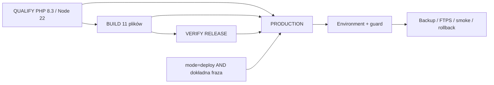

# Allegro — B.1.2: kwalifikacja release i bootstrap workflow

27.10.2026, Home & Garden Outlet, mgoutlet.pl.

**DECYZJA: STOP przed commitem/publikacją.** Mechanizm odtwarza się lokalnie z zadeklarowanych źródeł na starej bazie, ale bieżący zdalny main zawiera dziewięć nowszych commitów OLX. Obecny release zastąpiłby nowszy fragment współdzielonego panelu, a zachowanie tego fragmentu nie przejdzie przypiętej walidacji B.1.1. Nie zmieniano bazy, kodu OLX ani zabezpieczeń GitHub, nie wykonywano commitów lub operacji produkcyjnych.

Ponowna kwalifikacja według uzupełnionego zlecenia: 2026-10-27T19:21:59.624024+00:00. Aktualizacja istniejącego raportu, bez zmian implementacji.

## A. HEAD / branch / git status

Repozytorium: `C:/Users/Albert/Documents/Strona www/github-deploy`.
Lokalny HEAD: `849121bf20ec012f89c293b17e690ddf91c28b36`.
Gałąź: `codex/gbp-read-diagnostics`.
Odczytany default branch GitHub: **main**; repo publiczne.
Zdalny main w chwili kontroli: **df4c32cc77f2500a5ba238d892803f9afac1f7bd**.
API compare: ahead_by=9, behind_by=0 względem lokalnego HEAD. Nie wykonano fetch/rebase/merge w roboczym repozytorium.

Przeczytano cały faktyczny raport B.1.1 `reports/allegro-etap-b11-izolowany-release.md`. Nazwa `allegro-etap-b11-isolated-release.md` ze zlecenia nie istnieje; nie tworzono duplikatu. Faktyczny B.1: `reports/allegro-etap-b1.md`.

### Zmodyfikowane śledzone pliki na początku — sześć, zastane z B

- `C:/Users/Albert/Documents/Strona www/github-deploy/.github/workflows/deploy-getspace.yml`
- `C:/Users/Albert/Documents/Strona www/github-deploy/.gitignore`
- `C:/Users/Albert/Documents/Strona www/github-deploy/hosting/getspace/README.md`
- `C:/Users/Albert/Documents/Strona www/github-deploy/hosting/getspace/admin/.htaccess`
- `C:/Users/Albert/Documents/Strona www/github-deploy/hosting/getspace/admin/index.php`
- `C:/Users/Albert/Documents/Strona www/github-deploy/scripts/build-getspace.mjs`

Nie są nowymi zmianami tego audytu. W szczególności modyfikacja istniejącego deploy-getspace to wcześniejsze testy/wykluczenia Allegro; B.1.2 jej nie edytuje.

### Nieśledzone pliki na początku ponownej kontroli — rozwinięto katalog Allegro

- `C:/Users/Albert/Documents/Strona www/github-deploy/.github/workflows/deploy-allegro-infra-getspace.yml`
- `C:/Users/Albert/Documents/Strona www/github-deploy/documents/allegro-etap-b.md`
- `C:/Users/Albert/Documents/Strona www/github-deploy/hosting/getspace/admin/allegro/.htaccess`
- `C:/Users/Albert/Documents/Strona www/github-deploy/hosting/getspace/admin/allegro/bridge.js`
- `C:/Users/Albert/Documents/Strona www/github-deploy/hosting/getspace/admin/allegro/callback.php`
- `C:/Users/Albert/Documents/Strona www/github-deploy/hosting/getspace/admin/allegro/config.php`
- `C:/Users/Albert/Documents/Strona www/github-deploy/hosting/getspace/admin/allegro/http.php`
- `C:/Users/Albert/Documents/Strona www/github-deploy/hosting/getspace/admin/allegro/index.php`
- `C:/Users/Albert/Documents/Strona www/github-deploy/hosting/getspace/admin/allegro/lib.php`
- `C:/Users/Albert/Documents/Strona www/github-deploy/hosting/getspace/admin/allegro/oauth.php`
- `C:/Users/Albert/Documents/Strona www/github-deploy/hosting/getspace/admin/allegro/storage.php`
- `C:/Users/Albert/Documents/Strona www/github-deploy/reports/allegro-audyt-etap-a.md`
- `C:/Users/Albert/Documents/Strona www/github-deploy/reports/allegro-etap-b-lokalnie.md`
- `C:/Users/Albert/Documents/Strona www/github-deploy/reports/allegro-etap-b.md`
- `C:/Users/Albert/Documents/Strona www/github-deploy/reports/allegro-etap-b1.md`
- `C:/Users/Albert/Documents/Strona www/github-deploy/reports/allegro-etap-b11-izolowany-release.md`
- `C:/Users/Albert/Documents/Strona www/github-deploy/reports/allegro-etap-b12-release-bootstrap.md`
- `C:/Users/Albert/Documents/Strona www/github-deploy/reports/gbp-api-wniosek-2026-10-14.md`
- `C:/Users/Albert/Documents/Strona www/github-deploy/reports/gbp-media-diagnostics-2026-10-21.md`
- `C:/Users/Albert/Documents/Strona www/github-deploy/reports/google-merchant-naprawa-2026-10-18.md`
- `C:/Users/Albert/Documents/Strona www/github-deploy/reports/google-merchant-wdrozenie-2026-10-14.md`
- `C:/Users/Albert/Documents/Strona www/github-deploy/reports/google-showroom-wdrozenie-2026-10-15.md`
- `C:/Users/Albert/Documents/Strona www/github-deploy/reports/karty-produktow-propozycja-2026-10-09.md`
- `C:/Users/Albert/Documents/Strona www/github-deploy/reports/olx-audyt-2026-10-16.md`
- `C:/Users/Albert/Documents/Strona www/github-deploy/reports/olx-etap-b-wdrozenie-2026-10-20.md`
- `C:/Users/Albert/Documents/Strona www/github-deploy/reports/olx-etap-b1-hosting-2026-10-16.md`
- `C:/Users/Albert/Documents/Strona www/github-deploy/scripts/allegro-infra-release.py`
- `C:/Users/Albert/Documents/Strona www/github-deploy/scripts/allegro-infra-smoke.py`
- `C:/Users/Albert/Documents/Strona www/github-deploy/scripts/getspace-artifact-privacy.mjs`
- `C:/Users/Albert/Documents/Strona www/github-deploy/tests/allegro-artifact-tests.mjs`
- `C:/Users/Albert/Documents/Strona www/github-deploy/tests/allegro-http-tests.mjs`
- `C:/Users/Albert/Documents/Strona www/github-deploy/tests/allegro-infra-release-tests.py`
- `C:/Users/Albert/Documents/Strona www/github-deploy/tests/allegro-oauth-tests.php`

Niniejszy raport B.1.2 już istniał przed ponowną kontrolą i został zaktualizowany; nie utworzono nowego pliku śledzonego źródła. Zastane pliki pozostały niezmienione. Nie wykonano git add ani commit. Rozdział B klasyfikuje pliki Allegro, C dokładnie wyklucza dziewięć raportów innych prac.

**Zakres bieżącej edycji:** wyłącznie ten raport; wszystkie zastane źródła/workflow, OLX i pozostałe dokumenty zachowano bajt w bajt.

## B. Kompletny release set

**Kandydat: 28 konkretnych plików**, oparty na lokalnym HEAD, z dokumentacją tego audytu. Lista jest kompletna dla testowanego lokalnego snapshotu, ale **NIE jest obecnie zatwierdzonym zestawem do commitu na aktualnym main**. Po świadomym uzgodnieniu nowszej bazy konieczna jest ponowna kwalifikacja listy i hashów, bez cofania OLX.

### RUNTIME

| Pełna ścieżka | Etap | Stan |
|---|---|---|
| `C:/Users/Albert/Documents/Strona www/github-deploy/hosting/getspace/admin/allegro/.htaccess` | B | ?? |
| `C:/Users/Albert/Documents/Strona www/github-deploy/hosting/getspace/admin/allegro/config.php` | B | ?? |
| `C:/Users/Albert/Documents/Strona www/github-deploy/hosting/getspace/admin/allegro/storage.php` | B | ?? |
| `C:/Users/Albert/Documents/Strona www/github-deploy/hosting/getspace/admin/allegro/http.php` | B | ?? |
| `C:/Users/Albert/Documents/Strona www/github-deploy/hosting/getspace/admin/allegro/oauth.php` | B | ?? |
| `C:/Users/Albert/Documents/Strona www/github-deploy/hosting/getspace/admin/allegro/lib.php` | B | ?? |
| `C:/Users/Albert/Documents/Strona www/github-deploy/hosting/getspace/admin/allegro/bridge.js` | B | ?? |
| `C:/Users/Albert/Documents/Strona www/github-deploy/hosting/getspace/admin/allegro/callback.php` | B | ?? |
| `C:/Users/Albert/Documents/Strona www/github-deploy/hosting/getspace/admin/allegro/index.php` | B | ?? |
| `C:/Users/Albert/Documents/Strona www/github-deploy/hosting/getspace/admin/.htaccess` | B | M |
| `C:/Users/Albert/Documents/Strona www/github-deploy/hosting/getspace/admin/index.php` | B | M |

### CI / RELEASE

| Pełna ścieżka | Etap | Stan |
|---|---|---|
| `C:/Users/Albert/Documents/Strona www/github-deploy/.gitignore` | B | M |
| `C:/Users/Albert/Documents/Strona www/github-deploy/.github/workflows/deploy-getspace.yml` | B | M |
| `C:/Users/Albert/Documents/Strona www/github-deploy/.github/workflows/deploy-allegro-infra-getspace.yml` | B.1.1 | ?? |
| `C:/Users/Albert/Documents/Strona www/github-deploy/scripts/build-getspace.mjs` | B | M |
| `C:/Users/Albert/Documents/Strona www/github-deploy/scripts/getspace-artifact-privacy.mjs` | B | ?? |
| `C:/Users/Albert/Documents/Strona www/github-deploy/scripts/allegro-infra-release.py` | B.1.1 | ?? |
| `C:/Users/Albert/Documents/Strona www/github-deploy/scripts/allegro-infra-smoke.py` | B.1.1 | ?? |

### TESTY

| Pełna ścieżka | Etap | Stan |
|---|---|---|
| `C:/Users/Albert/Documents/Strona www/github-deploy/tests/allegro-oauth-tests.php` | B | ?? |
| `C:/Users/Albert/Documents/Strona www/github-deploy/tests/allegro-http-tests.mjs` | B | ?? |
| `C:/Users/Albert/Documents/Strona www/github-deploy/tests/allegro-artifact-tests.mjs` | B | ?? |
| `C:/Users/Albert/Documents/Strona www/github-deploy/tests/allegro-infra-release-tests.py` | B.1.1 | ?? |

### DOKUMENTACJA

| Pełna ścieżka | Etap | Stan |
|---|---|---|
| `C:/Users/Albert/Documents/Strona www/github-deploy/hosting/getspace/README.md` | B | M |
| `C:/Users/Albert/Documents/Strona www/github-deploy/documents/allegro-etap-b.md` | B | ?? |
| `C:/Users/Albert/Documents/Strona www/github-deploy/reports/allegro-etap-b.md` | B | ?? |
| `C:/Users/Albert/Documents/Strona www/github-deploy/reports/allegro-etap-b1.md` | B.1 | ?? |
| `C:/Users/Albert/Documents/Strona www/github-deploy/reports/allegro-etap-b11-izolowany-release.md` | B.1.1 | ?? |
| `C:/Users/Albert/Documents/Strona www/github-deploy/reports/allegro-etap-b12-release-bootstrap.md` | B.1.2 | nowy B.1.2 |

RUNTIME to dokładnie 11 przyszłych celów z allowlisty; CI i dokumentacja nie trafiają do public_html. `.gitignore` jest zabezpieczeniem SOURCE/CI. Istniejący builder całej witryny i istniejący workflow znajdują się na liście z powodu zastanych zmian B oraz zależności testu artifact/privacy od ich wykluczeń; **nie są wybraną ścieżką deploya Allegro**. Usunięcie tych plików z przyszłego zestawu bez zmiany kwalifikacji mogłoby rozspójnić testy na czystym checkoutcie.

Istniejące zależności (admin/lib.php, katalog lib, catalog.php, shop-test/config.php, kod i testy OLX, skrypty snapshot/prerender) są śledzone w bazie Git i nie wymagają kopiowania dodatkowego nieśledzonego pliku. Nie oznacza to zgody na ich zmianę lub wdrożenie. Historyczny BASE używany przez helper musi być dostępny; wszystkie checkouty nowego workflow mają fetch-depth: 0.

Trwała dokumentacja w zestawie: README z instrukcją infrastruktury, documents/allegro-etap-b (obsługa), pełny raport B (kontrakt/implementacja), B.1 (bramki Getspace), B.1.1 (profil wydania i odzyskiwanie), B.1.2 (bootstrap i aktualny blocker). Audyt A oraz skrót B-local są archiwalne i nie są konieczne do uruchomienia lub utrzymania tej infrastruktury — wykluczono je z commitu bez usuwania oryginałów.

### Wymagane testy odziedziczone z repozytorium

Poniższe pliki są już śledzone w bazie i zostaną zawarte w drzewie przyszłego commitu bez ponownego dodawania. Nie są nowymi zmianami 28-plikowego release:

- `C:/Users/Albert/Documents/Strona www/github-deploy/tests/olx-oauth-tests.php`
- `C:/Users/Albert/Documents/Strona www/github-deploy/tests/olx-http-tests.mjs`
- `C:/Users/Albert/Documents/Strona www/github-deploy/tests/olx-identity-verification-tests.mjs`
- `C:/Users/Albert/Documents/Strona www/github-deploy/tests/prerender-privacy-tests.mjs`
- `C:/Users/Albert/Documents/Strona www/github-deploy/tests/public-products-snapshot-tests.mjs`
- `C:/Users/Albert/Documents/Strona www/github-deploy/tests/product-id-migration-tests.php`
- `C:/Users/Albert/Documents/Strona www/github-deploy/tests/admin-figure-entry-tests.php`
- `C:/Users/Albert/Documents/Strona www/github-deploy/tests/catalog-presentation-tests.php`

## C. Pliki niewchodzące do release

Dziewięć zastanych nieśledzonych raportów niezwiązanych z release Allegro:

- `C:/Users/Albert/Documents/Strona www/github-deploy/reports/gbp-api-wniosek-2026-10-14.md`
- `C:/Users/Albert/Documents/Strona www/github-deploy/reports/gbp-media-diagnostics-2026-10-21.md`
- `C:/Users/Albert/Documents/Strona www/github-deploy/reports/google-merchant-naprawa-2026-10-18.md`
- `C:/Users/Albert/Documents/Strona www/github-deploy/reports/google-merchant-wdrozenie-2026-10-14.md`
- `C:/Users/Albert/Documents/Strona www/github-deploy/reports/google-showroom-wdrozenie-2026-10-15.md`
- `C:/Users/Albert/Documents/Strona www/github-deploy/reports/karty-produktow-propozycja-2026-10-09.md`
- `C:/Users/Albert/Documents/Strona www/github-deploy/reports/olx-audyt-2026-10-16.md`
- `C:/Users/Albert/Documents/Strona www/github-deploy/reports/olx-etap-b-wdrozenie-2026-10-20.md`
- `C:/Users/Albert/Documents/Strona www/github-deploy/reports/olx-etap-b1-hosting-2026-10-16.md`

Ponadto bezwarunkowo wykluczone: `C:/Users/Albert/Documents/Strona www/github-deploy/.local-cache/`, `C:/Users/Albert/Documents/Strona www/github-deploy/publish/`, cache Pythona, lokalne paczki, backupy, sesje testowe, env, prywatne configi, klucze, vaulty/tokeny/state/pending/logi oraz dane produkcyjne i uploady. Nie dodawać katalogów zbiorczym git add. Nie kopiować prywatnych credentiali do SOURCE/CI ani runtime.

Archiwalne pliki Allegro, również **poza przyszłym commitem**, bez usuwania oryginałów:

- `C:/Users/Albert/Documents/Strona www/github-deploy/reports/allegro-audyt-etap-a.md`
- `C:/Users/Albert/Documents/Strona www/github-deploy/reports/allegro-etap-b-lokalnie.md`

## D. Clean checkout / reprodukowalność

**PASS na jawnie wskazanej lokalnej bazie 849121b + lista B. FAIL kwalifikacji do aktualnego main.**

Utworzono lokalny clone istniejącej historii Git, bez sieci i bez tworzenia commitu, w `.local-cache/b12-recheck`. Na checkout starego HEAD nałożono tylko pliki listy B. Przed testami nie było tam `.local-cache`, publish, przeniesionych configów, sekretów ani tokenów. Istniejący raport skopiowano jako dokument, a po aktualizacji odświeżono jego kopię; nie jest zależnością wykonawczą. Nie kopiowano ignorowanych zasobów źródłowego katalogu roboczego. W lokalnym clone/checkout użyto opcji core.longpaths=true tylko dla tych poleceń, aby obsłużyć istniejące długie nazwy Windows; nie zmieniano globalnej konfiguracji Git ani uploadów oryginału.

Jawne narzędzia: PHP portable 8.5.11 z curl/sodium (wskazany interpreter, nie źródła aplikacji z cache), Node 24.22.1, Python 3.12.10, PyYAML 6.0.3. To nie kwalifikacja docelowego PHP 8.3/Node 22.

Dwa nowe buildy z pustych ścieżek w kopii dały identyczne bajty wszystkich **11** plików runtime. Manifesty są identyczne z wyjątkiem created_utc; commit/ref i Node są takie same. Odcisk źródeł runtime: `786244c17f5c425e56545307b36a35eb5067546df3e9b47a7986c45750479262`. SHA-256 manifestu recheck-a: `7a291c88769aa70ad465c6ede34df4ca48bb28f12b9a7ea62ab38919b7c11971`. To wynik lokalny, nie manifest produkcyjny. Utworzenie testowych atrap/sesji podczas testów nie jest zależnością od wcześniejszych prywatnych danych.

Nie gwarantuje się bitowej identyczności całego CI: znaczniki UTC, ref, rzeczywiste wersje patch narzędzi i surowe hashe źródeł przy innych końcach linii mogą się różnić. Payload ma LF i kontrolowane, zamrożone źródła. setup action tags i ubuntu-latest nie są pełnym lockiem środowiska.

### BLOCKER B12-BASE-01 — aktualny main jest nowszy

Odczyt GitHub porównał oba commity. Nowsze main dodaje m.in. `.github/workflows/deploy-olx-oauth.yml`, publikację/przygotowanie OLX i dodatkowe testy. `admin/index.php` ma dodatkowy 11-liniowy blok prezentacji statusu OLX, require olx/publish-lib.php i link przygotowania ogłoszenia. Lokalny B dodaje do starszego pliku wyłącznie link Allegro.

Przekopiowanie lokalnego index.php jako pełnego pliku na nowszą bazę usuwałoby ten blok OLX. Zachowanie nowszego bloku wraz z linkiem Allegro oznacza, że expected_files() nie uzyska starego BASE po odjęciu jednego linku — builder prawidłowo zatrzyma wydanie. Dodatkowo preflight dopuszcza jedynie stare preimages albo payload, więc nowszego pliku serwera nie nadpisze samoczynnie. Stan serwera nie był badany; zdalny Git nie jest dowodem wdrożenia.

**Nie rozwiązano automatycznie tego blockera.** Wymagane osobne uzgodnienie aktualnej bazy, zachowanie nowszego OLX, przegląd minimalnego diffu wspólnego panelu, świadome uaktualnienie pinów/preimages i ponowna regresja również nowych testów OLX. Nie pomijać walidatora, nie dopisywać obcego hasha bez przeglądu, nie cofać zmian main.

Nie wykryto brakującej nieśledzonej zależności na starej bazie. Przyszły jeden kompletny commit może reprezentować uzgodniony snapshot, ale **nie powstał i nie został przetestowany commit na aktualnej bazie main**.

## E. Wszystkie workflow GitHub

Sprawdzono wszystkie lokalne yml/yaml (dwa), katalog workflow aktualnego main (dwa) oraz listę Actions API (pięć rekordów). Treść zdalnego deploy-getspace po normalizacji LF jest równa wersji z lokalnego HEAD; jego pełną treść i lokalne dodatki przeczytano. Przeczytano cały dodatkowy zdalny workflow OLX.

| Nazwa | Plik / zakres | push | Branch filter | pull_request | workflow_dispatch | workflow_run | repository_dispatch | schedule | Deploy produkcyjny | Publikacja na main uruchomi? |
|---|---|---|---|---|---|---|---|---|---|---|
| Deploy to Getspace | .github/workflows/deploy-getspace.yml; lokalnie i main | TAK | main | NIE | TAK | NIE | NIE | NIE | TAK, pełny | TAK, jeśli active i bez skutecznej bariery |
| Allegro infrastructure ONLY (OAuth OFF) | .github/workflows/deploy-allegro-infra-getspace.yml; lokalnie | NIE | brak dla dispatch | NIE | TAK | NIE | NIE | NIE | Warunkowo, mode=deploy + fraza + env/guard | NIE, sam push nie |
| Deploy OLX OAuth code only | .github/workflows/deploy-olx-oauth.yml; main | NIE | brak dla dispatch | NIE | TAK | NIE | NIE | NIE | TAK, helper OLX/FTPS | NIE, sam push nie |
| Invoice document PHP 8.3 tests | .github/workflows/invoice-document-tests.yml; tylko rekord API, contents main 404 | nieustalone historycznie | nieustalone | nieustalone | nieustalone | nieustalone | nieustalone | nieustalone | Niepotwierdzone dla innych refów | Brak pliku na main w odczycie |
| Invoice production fix PHP 8.3 tests | .github/workflows/invoice-production-fix-tests.yml; tylko rekord API, main 404 | nieustalone historycznie | nieustalone | nieustalone | nieustalone | nieustalone | nieustalone | nieustalone | Niepotwierdzone dla innych refów | Brak pliku na main w odczycie |
| Paynow PHP 8.3 tests | .github/workflows/paynow-tests.yml; tylko rekord API, main 404 | nieustalone historycznie | nieustalone | nieustalone | nieustalone | nieustalone | nieustalone | nieustalone | Niepotwierdzone dla innych refów | Brak pliku na main w odczycie |

Aktualne dwa workflow main nie zawierają schedule, pull_request_target, merge_group, workflow_run, repository_dispatch ani workflow_call. Nie ma drugiego zidentyfikowanego automatycznego deploya na push main w badanym drzewie. OLX jest dodatkową **ręczną** ścieżką produkcyjną — musi być objęta oknem zmian, ale sam push jej nie wywoła. Trzy historyczne rekordy API nie są trzema istniejącymi plikami main. Przed bootstrapem ponowić inventory refu końcowego i aktualnych plików, innych gałęzi używanych do PR, merge queue oraz ewentualnych zewnętrznych integracji; nie rozszerzać gwarancji na nieodczytane refy lub webhooki.

Ponowny GET katalogu main zwrócił identyczne dwa blob SHA workflow jak w poprzedniej kontroli; publiczny Actions API nadal raportuje pięć tych samych rekordów active. Nie traktowano metadanych starych runów jako nowych definicji workflow. Pełne ścieżki obu lokalnych workflow są w zestawie B; zdalny dodatkowy plik to `https://github.com/gmgardenoutlet-lang/home-garden-outlet/blob/df4c32cc77f2500a5ba238d892803f9afac1f7bd/.github/workflows/deploy-olx-oauth.yml`.

## F. Konflikt bootstrapu

Default branch potwierdzony: main. workflow_dispatch musi być obecny na default branch, aby go wywołać, choć później można wybrać inny ref. Obecny produkcyjny workflow jest active i ma push main. Zwykły push/merge całego release może więc wywołać pełną produkcyjną operację bez zgody Allegro-only. Źródło: [GitHub — manual run](https://docs.github.com/en/actions/how-tos/manage-workflow-runs/manually-run-a-workflow).

Opublikowanie pliku workflow, jego ręczne wywołanie qualify-only i wdrożenie to trzy odrębne decyzje. Dodanie nowego workflow nie wyłącza starego. Nie wykonywano żadnej z tych operacji.

## G. Wariant A — [skip ci]

**RYZYKOWNY — odrzucony jako jedyna bramka bezpieczeństwa obecnego bootstrapu.** Semantyka push/PR jest potwierdzona dokumentacją; nie ustalono jednak kompletnych wymaganych checks i nie ma zatwierdzonego końcowego commitu. To nie niejasność reguły [skip ci], lecz brak wystarczającej gwarancji wykonawczej dla całej operacji.

GitHub dokumentuje pomijanie eventów push i pull_request przez znaczniki w komunikacie commitu, m.in. [skip ci]. Dla PR istotny jest commit HEAD; dla docelowego push main trzeba dopilnować komunikatu faktycznego commitu scalenia/squash, nie tylko wcześniejszego commitu na gałęzi. Rebase/squash/edycja komunikatu mogą zgubić znacznik. Pominięte required checks mogą pozostać Pending i zablokować PR. Nie usuwać wtedy znacznika w celu „naprawy” bez innej bariery deploya.

Znacznik nie zatrzymuje workflow_dispatch, workflow_run, repository_dispatch, pull_request_target, schedule, merge_group, release i innych eventów poza push/PR. Nie anuluje aktywnego ani zakolejkowanego joba. W badanych plikach main automatyczny event produkcyjny jest push, więc mieści się w udokumentowanej regule. To nie zastępuje odczytu branch protection ani ochrony przed ręcznym OLX/pełnym dispatch i równoległym kolejnym pushem.

Operacje zdalne: przyszły push/merge oznaczonego commitu, odczyt zdarzeń/checks. Ryzyko: utrata znacznika, Pending i wyścigi zmian. Rollback publikacji to kolejny commit/push, który również musi być chroniony — nie revert bez zabezpieczenia. Zgoda właściciela wymagana na commit/publikację i wybrany tryb scalenia. Niczego nie wykonano.

Źródło: [GitHub — skipping workflow runs](https://docs.github.com/en/actions/how-tos/manage-workflow-runs/skip-workflow-runs), odczyt 27.10.2026.

## H. Wariant B — disable/enable workflow

**REKOMENDOWANY WARUNKOWO**, po zamknięciu B12-BASE-01 i potwierdzeniu polityk; obecnie nie wykonywać.

To jawny zdalny disable konkretnego workflow Deploy to Getspace, odczyt potwierdzenia stanu disabled_manually, publikacja uzgodnionego commitu zgodnie z politykami gałęzi, kontrola nowego SHA i brak nowego uruchomienia deploya, następnie kontrolowane przywrócenie stanu active. Nie zmienia pliku starego workflow i nie zależy wyłącznie od komunikatu merge. Dokumentacja stwierdza, że disable zatrzymuje nowe wyzwolenia, **nie anuluje istniejących runów**; przed oknem trzeba potwierdzić brak aktywnych/queued/pending deployów i wykluczyć równoległe ręczne Actions/FTPS.

Jeżeli required check zależy od wyłączonego workflow, publikacja może zostać zablokowana. Wtedy STOP: nie omijać branch protection, nie usuwać checka automatycznie. Wcześniej ustalić zgodny sposób kwalifikacji z właścicielem. Wyłączenie joba produkcyjnego jako checka nie powinno służyć wymuszonemu scaleniu.

Operacje zdalne wymagające osobnej zgody: disable, commit/push/merge, odczyt potwierdzeń i enable. Łatwo przywrócić sam stan workflow, lecz nie publikować przez revert przy aktywnym push deploy. Zakres wyłączenia i termin odpowiedzialnej osoby muszą być zapisane; nie pozostawiać automatycznie wyłączonego bez decyzji ani nie włączać go bez sprawdzenia kolejki i kolejnych zmian.

**Ważne po enable:** następny zwykły push main znów może wdrożyć cały serwis i źródłowy loader B, zamiast zamrożonego payloadu OFF B.1.1. Bootstrap nie rozwiązuje przyszłej polityki pełnych wydań. Ponowne enable wymaga potwierdzenia, że kolejny pełny deploy nie jest niezatwierdzoną ścieżką Allegro i zachowa OFF; w razie braku tego warunku utrzymać STOP i uzgodnić osobne rozwiązanie C. Nie zakłada się, że włączenie workflow kwalifikuje obecny kod do pełnego wdrożenia.

Źródło: [GitHub — disable/enable workflows](https://docs.github.com/en/actions/how-tos/manage-workflow-runs/disable-and-enable-workflows), odczyt 27.10.2026.

Wymagane uprawnienia: write do repo dla sterowania workflow (UI/CLI), a dla REST token z właściwymi Actions write; pełne potwierdzenie na wybranym koncie przed przyszłą operacją, bez poszerzania uprawnień teraz. Właściciel musi zatwierdzić zarówno disable, jak i warunki enable. W runbooku zapisać ID/plik, pierwotny stan active, odpowiedzialną osobę i termin odtworzenia. Sprawdzić stan końcowy odczytem, nie polegać na pamięci operatora. Nie wykonywać automatycznego enable po utracie dowodów albo jeśli następny pełny deploy naruszyłby profil OFF — wtedy jawny STOP i decyzja właściciela.

## I. Wariant C — zmiana triggera

**NIEZALECANY w tym audycie; możliwy jako osobny, trwały projekt polityki wydań.** Usunięcie push main lub dodatkowy jawny gate ogranicza przyszłe automatyczne deploye, lecz zmienia istniejący proces właściciela. Wymaga osobnego przeglądu całego workflow, branch protection, wymaganych checks i sposobu wprowadzenia samej pierwszej zmiany; nie uznawać komentarza/path filter za wystarczającą barierę.

Operacje zdalne: chroniony commit/PR/merge/push oraz późniejsze testy Actions po zgodzie. Ryzyko: sam moment bootstrapu, unieruchomienie dotychczasowego procesu, Pending/niedopasowanie required checks; cofnięcie triggera może przywrócić niechciany deploy. Bezpieczne wprowadzenie takiej zmiany również warto osłonić wariantem B. Każda zmiana triggera i jej przywrócenie wymaga zgody właściciela. Nie przygotowano zmiany pliku w B.1.2.

## J. Wariant D — PR / merge

**RYZYKOWNY jako samodzielny bootstrap; PR jest przydatny do przeglądu, lecz nie blokuje deploya po merge.** Otworzenie PR i przegląd diffu pomagają zachować nowe OLX i ustalić końcowy snapshot. Po merge do main dochodzi jednak do zmiany main, którą obsługuje obecny push workflow. Brak triggera pull_request w pełnym deployu nie chroni samego scalenia.

Wymagane są zgodne z polityką approvals, required checks, aktualna baza, ewentualne CODEOWNERS i merge queue. Szczegółowe ustawienia są NIEPOTWIERDZONE; protected=false i puste publiczne listy nie stanowią zgody na direct push ani na pomijanie przeglądu. Nowy workflow ma wyłącznie workflow_dispatch, więc samo otwarcie PR nie uruchomi kwalifikacji Allegro. Przed rejestracją na default branch nie należy obiecywać, że da się uruchomić go ręcznie tylko dlatego, że znajduje się na gałęzi PR.

Merge/squash/rebase mogą zmienić SHA i komunikat. Nie przenosić automatycznie gwarancji [skip ci] z HEAD PR na końcowy push main; końcowy SHA trzeba osobno kwalifikować, a przy wymaganych checks Pending oznacza STOP, nie admin bypass. Nie włączać auto-merge ani merge queue bez odrębnej analizy eventów i kontroli chwili publikacji.

Operacje zdalne: przyszły push gałęzi, utworzenie PR, review i jawny merge — każda dopiero w zatwierdzonym zakresie. Nie utworzono PR, nie publikowano gałęzi i nie scalano. Cofnięcie PR po publikacji jest kolejną zmianą main i samo może wywołać deploy. PR można użyć **wewnątrz rekomendowanego wariantu B**, z barrierą disabled przed finalnym merge, ale D sam nie spełnia celu braku przypadkowego deploya.

Źródła: [GitHub — merge PR](https://docs.github.com/en/pull-requests/how-tos/merge-and-close-pull-requests/merging-a-pull-request), [ochrona gałęzi](https://docs.github.com/en/repositories/configuring-branches-and-merges-in-your-repository/managing-protected-branches/about-protected-branches), ponownie odczytane 27.10.2026.

## K. Inne rozwiązanie

Rozważono osobne repo/gałąź kwalifikacji i dwuetapowy bootstrap małego manualnego workflow. Osobna kwalifikacja bez FTP może dostarczyć dowodu runtime, lecz nie usuwa wymogu rejestracji workflow na default branch docelowego repo. Minimalny commit rejestracyjny nadal wyzwala istniejący push main. Zdalne utworzenie refu, API contents/merge albo tag nie są sposobem obejścia reguły eventów i zasad ochrony. Nie rekomenduje się ich jako samodzielnej gwarancji.

Oddzielny neutralny CI do required checks może być potrzebny, jeśli polityki wymagają testów, ale byłby nową, osobno przejrzaną zmianą. Nie tworzono go, nie uruchamiano zdalnej kwalifikacji ani nowego repo. Sama lokalna kopia użyta w D nie rejestruje workflow na GitHub.

## L. Rekomendacja — jedna metoda

**B — jawne, czasowe wyłączenie pełnego Deploy to Getspace w zatwierdzonym oknie**, z odczytem potwierdzenia i brakiem aktywnych deployów, potem publikacja kompletnego snapshotu zgodna z branch protection. Nie jest to zgoda ani polecenie realizacji teraz.

Kolejność przyszła: zamknąć rozbieżność bazy → ponownie testować zachowany aktualny OLX i release → potwierdzić ustawienia/required checks → przedstawić konkretny końcowy ref i diff → uzyskać zgodę na bootstrap i zmianę stanu workflow → potwierdzić disable/brak aktywnych runów → opublikować bez force-push zgodnie z politykami → odczytać SHA/pliki i brak przypadkowego deploya → uzgodnić bezpieczne enable/politykę kolejnych pełnych deployów. Jeśli choć jeden krok nie ma dowodu, STOP.

Dopiero po osobnej zgodzie na uruchomienie Actions wybrać nowy workflow i qualify-only na dokładnym refie. Jeszcze inna zgoda jest potrzebna na production mode=deploy. Nie zmieniać tego na ręczny dispatch starego workflow.

## M. Branch protection

**BRANCH PROTECTION — NIEPOTWIERDZONE w pełnym wymaganym zakresie.** Odczyty publicznego API (bez credentiali):

| Element | Dowód | Ocena |
|---|---|---|
| Default branch | connector get_repo: main | POTWIERDZONE |
| Widoczność i permission connectora | public; push/admin=true | POTWIERDZONE; to nie zgoda na działanie |
| branches/main | 200, protected=false, SHA df4c32c… | POTWIERDZONY raport API w chwili odczytu |
| rules/branches/main | 200, [] | Brak reguł zwróconych przez ten odczyt |
| rulesets | 200, [] | Brak zwróconych rulesets |
| branches/main/protection | 401 | Szczegóły required checks/reviews nieodczytane |
| Direct push / wymagane approvals / bypass | brak autoryzowanego odczytu szczegółów | NIEPOTWIERDZONE; nie próbowano push |

Nie zamieniono protected=false na pełną gwarancję dozwolonego direct push. Właściciel ma sprawdzić Settings/Branches oraz Rules/Rulesets: reguły main i wybranego refu, require PR, liczbę approvals, CODEOWNERS, stale reviews, status checks (dokładne nazwy i expected app), strict up-to-date, merge queue, podpisy/linear history, push restrictions, bypass/administratorów, ewentualne wymagane deployments i ustawienia Actions. Ustalić, czy check pełnego deploya jest wymagany oraz jak wpłynie disable i [skip ci]. Nie zmieniać tych zasad na potrzeby audytu.

Źródło: [GitHub — protected branches](https://docs.github.com/en/repositories/configuring-branches-and-merges-in-your-repository/managing-protected-branches/about-protected-branches).

## N. GitHub Environment

**GITHUB ENVIRONMENT — NIEPOTWIERDZONE.** Publiczny GET environments/allegro-infra-production zwrócił 404; odczyt wyłącznie metadanych/nazw environment secrets zwrócił 401. Nie uznano 404 bez uwierzytelnionego odczytu administracyjnego za dowód konfiguracji lub jej poprawności. Żadnej wartości sekretu nie odczytywano ani nie żądano endpointu ujawniającego wartość.

Właściciel ma potwierdzić: istnienie dokładnej nazwy, required reviewers i realnego drugiego recenzenta, prevent self-review, can_admins_bypass=false, selected branches/tags lub protected branches (przy protected=false sam wybór protected branches może nie dopuścić main), uprawnienia planu/publicznego repo, brak automatycznego tworzenia niechronionego env, nazwy/scope pięciu ALLEGRO_FTP_*/ALLEGRO_SMOKE_ADMIN_COOKIE secrets oraz ich izolację od qualify/build/verify. Nie wklejać wartości w raport.

Guard wymaga pozytywnego odczytu reguł i zatrzymuje transfer przy braku pola/odpowiedzi. To warunek przed deployem, nie powód do uruchomienia produkcyjnego joba teraz. qualify-only nie potrzebuje environment ani tych sekretów.

Źródło: [GitHub — environments](https://docs.github.com/en/actions/how-tos/deploy/configure-and-manage-deployments/manage-environments).

## O. QUALIFY-only — pełny graf bezpieczeństwa

**PASS analizy statycznej badanego lokalnego workflow.** Graf:

Production ma job-level if `inputs.mode == 'deploy' && inputs.confirmation == 'DEPLOY_ALLEGRO_INFRA_OAUTH_OFF'` oraz needs [qualify,build,verify]. Dla mode=qualify-only pierwsza część jest false niezależnie od confirmation, więc job produkcyjny jest skipped; nie uruchamia environment ani kroków guard/FTPS/smoke/rollback. Nie ma alternatywnej krawędzi, workflow_call, zagnieżdżonego dispatch ani produkcyjnych sekretów na poziomie workflow lub trzech lokalnych jobów.

Polecenia qualify/build/verify odczytano; nie wywołują helpera w trybie backup/deploy/rollback/guard --execute. Python unittest używa FakeRemote i podmienionego FTP_TLS, a próby CLI zdalnych działań bez --execute kończą się przed siecią. HTTP testy łączą się z localhost, mają syntetyczne dane i atrapy token/me/refresh, nie prawdziwe endpointy Allegro/OLX. save_product test działa na izolowanej kopii. Public snapshot/prerender regresje mają własne fixture. Komunikaty/symulowane żądania /me w testach nie są połączeniem z realnym /me.

Żaden z tych trzech jobów nie wywołuje olx-production-prepare, deploy-olx-oauth ani produkcyjnego migratora productId. Lokalny dodatkowy test migratora w sekcji R korzysta wyłącznie z syntetycznych danych i nie jest krokiem QUALIFY. Warunki always() dla rollbacku i artefaktu odzyskiwania są wewnątrz production; nie omijają job-level if. Przy qualify-only nie ma więc również ścieżki do backupu ani smoke produkcji, w tym przez krok awaryjny.

Zdalne pobranie source/actions/paczek narzędzi jest normalnym działaniem CI, lecz żaden job qualify-only nie ma ścieżki do produkcyjnego FTP, OAuth, /me, /sale albo mutacji OLX. Wspólna grupa concurrency może jedynie opóźnić inny run; nie uruchamia go. Dowód dotyczy przejrzanego kodu i nie stanowi gwarancji wobec przyszłych zmian lub skompromitowanych zależności Actions.

## P. PHP 8.3 / Node 22

QUALIFY faktycznie używa actions/setup-node@v4 z node-version '22', shivammathur/setup-php@v2 z php-version '8.3', extensions curl,sodium, coverage none. Uruchamia również kontrolę PHP_MAJOR_VERSION===8 && PHP_MINOR_VERSION===3 oraz major Node===22. Python jest przygotowany przez setup-python@v5, python-version '3.12'; PyYAML==6.0.2 instalowane w qualify i verify. BUILD/VERIFY/PRODUCTION przygotowują Node22/Python3.12; VERIFY ma także PHP8.3 curl/sodium i lint paczki.

Konfiguracja: PASS statycznie. **Rzeczywisty wynik PHP8.3/Node22 w Actions: NIEPOTWIERDZONY**, bo nie wolno było uruchamiać Actions. Lokalne PASS 8.5/24 nie zastępuje tego warunku. Nie instalowano systemowo nowych runtime ani pakietów.

## Q. Manifest

Przyszły manifest CI musi pochodzić ze świeżego builda tego samego przejrzanego commitu, który przeszedł QUALIFY. Wymagane:

1. Commit=GITHUB_SHA i ref=GITHUB_REF; wszystkie pliki source są częścią tego commitu, brak nieśledzonego overlay, checkout ma pełną historię BASE. Zarchiwizować identyfikator runu i wynik testów wraz z manifestem; sam odcisk runtime nie obejmuje całego SOURCE/CI.
2. Dokładnie 11 targetów, zgodne źródła, source_sha256 i sha256 payloadu; brak dodatkowych plików/katalogów/symlinków/private/produktów/uploads. Manifest poza runtime.
3. Zamrożony odcisk przejrzanego modułu oraz aktualnie zatwierdzone preimages współdzielonych plików. Obecny BASE musi zostać uzgodniony z nowszym main przed kwalifikacją nowego wydania.
4. Profil `B.1.1-OAUTH-OFF-v1`, obie flagi false i sale_api_enabled=false; jedyna transformacja loadera jest dokładna i odtwarzalna. Node rzeczywiście v22, PHP8.3 przetestowane, UTC prawidłowy.
5. Odtworzenie payloadu ze źródeł w VERIFY i ponowny VERIFY przed transferem. Artefakt pobrany z tego samego runu, poprawne przekazanie ukrytych .htaccess, zero sekretów w manifestach/logach.

Łańcuch commit → źródła → build → 11 payloadów → hashe jest zaimplementowany, lecz bieżący lokalny manifest nadal wskazuje stary HEAD i robocze nieśledzone źródła. Nie używać go produkcyjnie. GitHub Actions tags i wersje major nie są kryptograficznym dowodem wszystkich zależności; ważne są również przegląd finalnego commitu i log kwalifikacji.

## R. Testy

Wykonano w lokalnej kopii z D, bez testów zdalnych. PASS dotyczy starej bazy z kandydatem release; nowe zdalne testy OLX preparation/publication nie istnieją w tej bazie i **nie są objęte tym wynikiem**.

| Kontrola | Wynik |
|---|---|
| tests/allegro-infra-release-tests.py | PASS — 17 testów |
| tests/allegro-infra-release-tests.py --release .local-cache/recheck-a | PASS — 17 testów na zbudowanej paczce |
| tests/allegro-oauth-tests.php | PASS — 197 asercji |
| tests/allegro-http-tests.mjs | PASS, także izolowany save_product |
| tests/allegro-artifact-tests.mjs | PASS |
| artifact test faktycznego runtime recheck-a | PASS |
| tests/olx-oauth-tests.php | PASS |
| tests/olx-http-tests.mjs | PASS |
| tests/olx-identity-verification-tests.mjs | PASS |
| tests/prerender-privacy-tests.mjs | PASS |
| tests/public-products-snapshot-tests.mjs | PASS |
| tests/product-id-migration-tests.php | PASS — dane syntetyczne |
| tests/admin-figure-entry-tests.php | PASS |
| tests/catalog-presentation-tests.php | PASS |
| Dwa buildy, verify, zgodność 11 payloadów | PASS; manifest różni tylko UTC |
| PHP lint siedmiu modułowych PHP i współdzielonego index | PASS |
| PHP lint wszystkich ośmiu PHP payloadu | PASS |
| node --check bridge.js | PASS |
| Python AST trzech plików | PASS |
| YAML parse wszystkich lokalnych workflow | PASS |
| bash -n wszystkich 33 lokalnych bloków run (12 w nowym) | PASS |
| git diff --check | PASS |
| Dopasowanie do nowszego współdzielonego panelu main | BLOCKER B12-BASE-01, bez zmiany źródeł |
| Faktyczne PHP8.3/Node22 w CI | NIE URUCHOMIONO |

Nie wykonywano pełnego builda witryny ani migracji produktów. Syntetyczne testy nie wymagają tokenów produkcji. Nie nazywa się ich regresją nowego OLX z aktualnego main.

Ponowna kontrola: **0 FAIL wykonanych lokalnych testów**. Release unittest: 17/17 PASS bez paczki wejściowej i 17/17 PASS z faktyczną paczką (te same 17 przypadków wykonane w dwóch profilach, nie 34 różne testy). Core Allegro: dokładnie 197 asercji PASS, zgodnie z B.1.1. Pozostałe zestawy nie raportują liczby asercji, więc jej nie wymyślano. Wyniki testów nie różnią się od B.1.1; nowym względem B.1.1 ograniczeniem pozostaje odkryta w B.1.2 rozbieżność nowszej bazy main.

## S. Operacje zewnętrzne

| Operacja | Wykonano |
|---|---|
| commit | NIE |
| push | NIE |
| merge / PR merge | NIE |
| utworzenie PR | NIE |
| Actions run | NIE |
| workflow disable/enable | NIE |
| GitHub settings / branch protection | NIE |
| Environment / secrets creation/update | NIE |
| FTPS | NIE |
| deploy | NIE |
| Getspace login | NIE |
| OAuth Allegro | NIE |
| rzeczywiste /me | NIE |
| rzeczywiste /sale | NIE |
| OLX zmieniony | NIE |
| Read-only GitHub API i oficjalna dokumentacja | TAK — metadane i publiczny kod; bez wartości sekretów |

Bieżąca zmiana lokalna: aktualizacja wyłącznie istniejącego raportu B.1.2. Utworzono świeżą ignorowaną kopię i dowody testów, nie modyfikując źródeł oryginału. Nie wykonywano git add, nie zmieniano starego workflow ani konfiguracji GitHub.

## T. DECYZJA

### Czy release jest kompletny i gotowy do przyszłego commitu?

**NIE.** Lista lokalnego kandydata jest kompletna i mechanizm przechodzi testy na starej bazie, ale nie jest uzgodniony z dziewięcioma nowszymi commitami main. Przed commitem trzeba zachować nowszy panel/OLX, ponownie przejrzeć piny/preimages i wykonać kwalifikację aktualnej bazy. Brakuje też rzeczywistego CI 8.3/22 i pełnego odczytu polityk.

### Czy istnieje bezpieczna metoda wprowadzenia workflow do default branch bez przypadkowego produkcyjnego deploya?

**TAK — warunkowo, jako procedura B po potwierdzeniu wszystkich bramek.** Jej wykonalność w aktualnej konfiguracji required checks nie jest jeszcze potwierdzona; nie jest gotowa do wykonania teraz. Wyłączenie dotyczy nowych wyzwoleń, dlatego wymagane są też brak aktywnych runów i kontrolowane okno zmian. [skip ci] nie jest samodzielną gwarancją tego repo.

### Jaka dokładnie metoda jest rekomendowana?

Wariant B: po uzgodnieniu aktualnej bazy i osobnej zgodzie właściciela czasowo wyłączyć pełny deploy, potwierdzić wyłączenie i brak istniejących deployów, opublikować kompletny przejrzany commit zgodnie z ochroną main, potwierdzić brak przypadkowego uruchomienia, uzgodnić bezpieczne ponowne włączenie i politykę kolejnych pełnych wydań. Dopiero osobno zatwierdzony qualify-only, następnie ewentualnie osobno zatwierdzony deploy Allegro-only.

### Czy możemy już wykonać commit/push?

**NIE — bez osobnej zgody właściciela, a obecnie dodatkowo STOP B12-BASE-01.**

### Czy możemy wykonać deploy?

**NIE.** Kwalifikacja CI, uzgodnienie release i bramki GitHub/Getspace nie są zamknięte.

### Czy możemy wykonać OAuth?

**NIE.** G16 i pozostałe bramki B.1 nie zostały zamknięte. Pierwszy release ma pozostać OFF; żaden wynik audytu bootstrapu tego nie zmienia.

Prace B.1.2 kończą się tym raportem. Nie podejmowano automatycznej naprawy blockerów.
